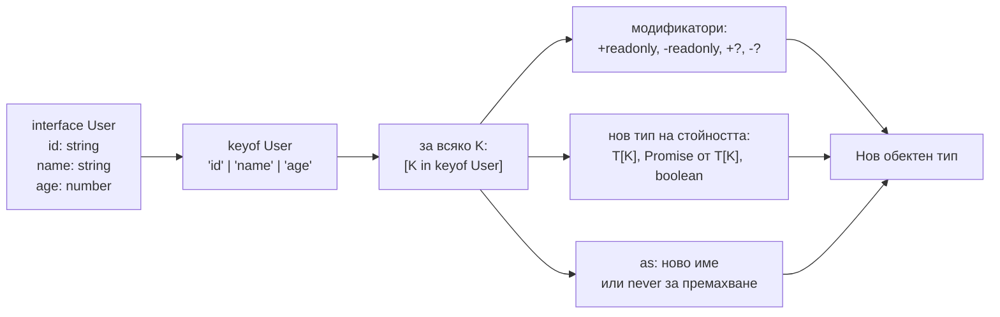

# Mapped и template literal типове

Mapped type създава нов обектен тип, като обхожда ключовете на друг: `{ [K in keyof T]: ... }` е `for` цикъл на ниво типове. Може да добавя или маха модификатори (`readonly`, `?`), да сменя типа на всяко свойство и, с клаузата `as`, да преименува или филтрира ключове. Template literal типовете (`` `on${string}` ``) правят същото за низове: строят и разпознават низови литерални типове.

## 1. За какво се ползва и защо ни е нужен

Mapped типовете стоят зад `Partial`, `Required`, `Readonly`, `Pick` и `Record`. В приложен код помагат да не дублираш:

- DTO за update, където всички полета са опционални (`Partial<User>`);
- обект с флагове или валидационни грешки за всяко поле на формуляр (`{ [K in keyof Form]?: string }`);
- getters и event handlers, изведени от имената на полетата (`getName`, `onNameChange`);
- типизирани ключове на събития (`'user:created' | 'user:deleted'`).

## 2. Как работи



## 3. Минимален пример

```ts mapped.ts
interface User {
  id: string;
  name: string;
  age: number;
}

// Същото като вградения Partial
type MyPartial<T> = { [K in keyof T]?: T[K] };

// Махане на модификатори с "-": всичко задължително и записваемо
type Mutable<T> = { -readonly [K in keyof T]-?: T[K] };

// Смяна на типа на всяко поле
type Flags<T> = { [K in keyof T]: boolean };
type UserFlags = Flags<User>;                 // { id: boolean; name: boolean; age: boolean }

type FieldErrors<T> = { [K in keyof T]?: string };
const errors: FieldErrors<User> = { age: 'Трябва да е над 18' };

// Преименуване с "as" и template literal
type Getters<T> = {
  [K in keyof T as `get${Capitalize<string & K>}`]: () => T[K];
};
type UserGetters = Getters<User>;             // { getId: () => string; getName: () => string; getAge: () => number }

// Филтриране с "as ... never": само полетата от даден тип
type PickByType<T, V> = {
  [K in keyof T as T[K] extends V ? K : never]: T[K];
};
type StringFields = PickByType<User, string>; // { id: string; name: string }
```

## 4. Template literal типове

```ts template.ts
type Entity = 'user' | 'order';
type Action = 'created' | 'deleted';

// Декартово произведение на union-и
type EventName = `${Entity}:${Action}`;
// 'user:created' | 'user:deleted' | 'order:created' | 'order:deleted'

// Вградени трансформации на низове
type Upper = Uppercase<'get'>;                // 'GET'
type Handler = `on${Capitalize<'click'>}`;    // 'onClick'

// Парсване с infer
type RouteParams<Path extends string> =
  Path extends `${string}:${infer Param}/${infer Rest}`
    ? Param | RouteParams<`/${Rest}`>
    : Path extends `${string}:${infer Param}`
      ? Param
      : never;

type P = RouteParams<'/users/:userId/orders/:orderId'>;   // 'userId' | 'orderId'

function route<Path extends string>(path: Path, params: Record<RouteParams<Path>, string>) {
  return path.replace(/:(\w+)/g, (_, k: string) => params[k as RouteParams<Path>]);
}
route('/users/:userId', { userId: '42' });                // ОК
route('/users/:userId', { id: '42' });                    // Грешка: липсва userId
```

Така работят типизираните routers (Express типове, Hono, TanStack Router): параметрите се извеждат от самия низ на пътя.

## 5. Homomorphic mapped types

Mapped тип от формата `{ [K in keyof T]: ... }` (директно върху `keyof T`) се нарича homomorphic. Той запазва модификаторите на оригинала (`readonly` и `?`), а приложен върху масив или tuple, дава масив или tuple, а не обект с ключове `length`, `push` и т.н. `Partial<[string, number]>` е `[string?, number?]`.

## 6. Въпроси на интервю

### Какво е mapped type?

Тип, който създава обектен тип, като обхожда union от ключове: `{ [K in Keys]: Type }`. Най-често ключовете са `keyof T`, така че новият тип има същите полета като `T`, но с променени модификатори или типове.

### Как работят модификаторите `-readonly` и `-?`?

Префикс `-` маха модификатора, `+` (или без префикс) го добавя. `{ -readonly [K in keyof T]-?: T[K] }` прави всички полета записваеми и задължителни. Така е написан вграденият `Required`.

### Как махаш ключове с mapped type?

С клаузата `as` (TS 4.1): ако изразът след `as` даде `never`, ключът изчезва. `[K in keyof T as T[K] extends Function ? never : K]` оставя само полетата, които не са функции.

### Какво са template literal типове?

Низови литерални типове, построени с шаблон: `` `prefix-${T}` ``. При union в шаблона резултатът е всички комбинации. С `infer` в шаблона можеш да разпознаваш и разбиваш низове на ниво типове, например параметрите от URL шаблон.

## 7. Капани и чести грешки

- `Capitalize<K>`, когато `K` може да е `number` или `symbol`. Пиши `Capitalize<string & K>`.
- Комбинаторна експлозия: template literal от няколко големи union-а прави десетки хиляди членове и бавна компилация.
- Mapped тип върху `keyof T`, когато `T` има индексна сигнатура: получаваш индексна сигнатура, не конкретни полета.
- Очакване, че mapped тип създава runtime обект. Той е само тип; стойността трябва да я построиш сам.

## 8. Свързани документи

- [keyof, typeof, indexed access](Type_Operators.md)
- [Conditional types и infer](Conditional_Types.md)
- [Utility types отвътре](Utility_Types.md)
- [Generics](Generics.md)
