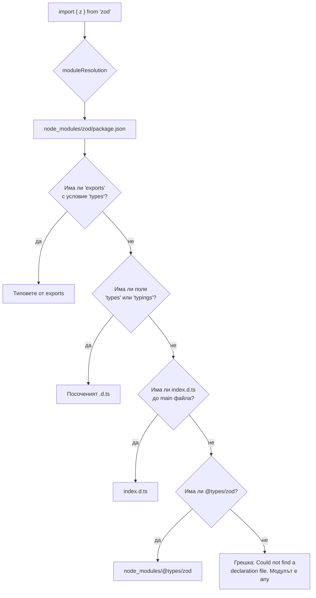

# Модули и .d.ts файлове

`.d.ts` файлът съдържа само типове, без имплементация: описва формата на JavaScript код, за да може TypeScript да го проверява. Когато пишеш `import express from 'express'`, компилаторът намира JavaScript файла на пакета за runtime и отделно неговите декларации за типовете: в самия пакет (полето `types` или `exports`) или в `@types/express`. С `declare` и module augmentation можеш да опишеш или разшириш чужди типове.

## 1. За какво се ползва и защо ни е нужен

Огромна част от npm е написана на JavaScript. За да ги ползва типизирано, TypeScript разчита на декларации. На интервю и в работа се сблъскваш с:

- грешката `Could not find a declaration file for module 'x'`;
- нуждата да добавиш поле към `Request` на Express или към `process.env`;
- типове за глобални променливи, инжектирани от build инструмента (`import.meta.env`, `__APP_VERSION__`);
- публикуване на собствена библиотека с типове;
- разлики между `moduleResolution` режимите, които дават `Cannot find module` само в някои среди.

## 2. Откъде идват типовете на един import



| `moduleResolution` | За какво | Особеност |
|---|---|---|
| `nodenext` / `node16` | Код, който се изпълнява директно в Node | Уважава `exports`, `type: module`, изисква разширения в относителните ESM пътища (`./user.js`) |
| `bundler` | Код, който минава през Vite, webpack, esbuild | Уважава `exports`, но не изисква разширения |
| `node10` (стар `node`) | Само CommonJS, стари проекти | Игнорира `exports`. Остарял |

## 3. Минимален пример: декларации

```ts env.d.ts
// Глобални типове за променливи на средата (Node)
declare global {
  namespace NodeJS {
    interface ProcessEnv {
      DATABASE_URL: string;
      NODE_ENV: 'development' | 'production' | 'test';
    }
  }
  const __APP_VERSION__: string;          // инжектирана от bundler-а с define
}

// Декларация за пакет без типове
declare module 'legacy-slugify' {
  export default function slugify(input: string, opts?: { lower?: boolean }): string;
}

// Импорти на файлове, които не са код (Vite, webpack)
declare module '*.svg' {
  const url: string;
  export default url;
}

export {};                                 // прави файла модул, за да работи "declare global"
```

## 4. Module augmentation

```ts express-augment.d.ts
import 'express-serve-static-core';

declare module 'express-serve-static-core' {
  interface Request {
    user?: { id: string; roles: string[] };   // слива се с оригиналния interface Request
    requestId: string;
  }
}
```

Работи благодарение на declaration merging на interfaces (виж [type срещу interface](Type_vs_Interface.md)). Файлът трябва да е модул (да има `import` или `export`), иначе `declare module` създава нова декларация, вместо да разшири съществуващата.

## 5. Генериране на декларации за библиотека

```json package.json
{
  "name": "@acme/money",
  "type": "module",
  "exports": {
    ".": {
      "types": "./dist/index.d.ts",
      "import": "./dist/index.js",
      "require": "./dist/index.cjs"
    }
  },
  "files": ["dist"]
}
```

`tsc` с `declaration: true` генерира `.d.ts` до всеки `.js`. Условието `types` трябва да е първо в обекта. За проверка на публикувания пакет: инструментът `@arethetypeswrong/cli`.

## 6. import type и verbatimModuleSyntax

```ts imports.ts
import type { User } from './user.js';          // само тип: изтрива се изцяло при компилация
import { createUser, type Role } from './user.js';  // смесено: Role се изтрива, createUser остава
```

С `verbatimModuleSyntax: true` правилото е просто: всеки `import` без `type` остава в изхода точно както е написан, всеки `import type` изчезва. Това прави поведението предвидимо за инструменти, които компилират файл по файл, и предотвратява изненади, при които import само на тип случайно изпълнява модул със странични ефекти (или обратното).

## 7. Въпроси на интервю

### Какво е `.d.ts` файл?

Файл с декларации на типове без имплементация. Описва формата на JavaScript модул или глобални стойности. Генерира се от `tsc` с `declaration: true` или се пише ръчно за JavaScript код. Компилаторът не генерира JavaScript от него.

### Какво е DefinitelyTyped?

Общностно хранилище с типове за JavaScript пакети, публикувани като `@types/<име>`. Ползва се, когато пакетът сам не включва типове. Версията на `@types` пакета трябва да съответства на версията на библиотеката.

### Какво прави `declare`?

Казва на компилатора, че нещо съществува в runtime, без да генерира код за него. `declare const VERSION: string`, `declare module 'x'`, `declare global {}`. Ползва се за код, който идва отвън (глобални скриптове, bundler дефиниции, JS пакети).

### Какво е module augmentation?

Разширяване на типовете на съществуващ модул чрез `declare module 'име'` в модулен файл. Използва declaration merging, за да добави полета към интерфейси на библиотеката, например `Request.user` в Express.

### Каква е разликата между `moduleResolution: nodenext` и `bundler`?

`nodenext` симулира точно правилата на Node: ESM изисква разширения на файловете, `exports` е задължителен за подпътища, `type: module` определя формата. `bundler` симулира Vite и webpack: уважава `exports`, но позволява пътища без разширения. Избираш според това какво ще изпълни кода.

## 8. Капани и чести грешки

- `declare module` във файл без `import`/`export`: създава нов модул, вместо да разшири съществуващия.
- `@types` пакет с версия, различна от библиотеката.
- `moduleResolution: bundler` за код, който се пуска директно с Node: компилира се, но гърми в runtime за липсващо разширение.
- `types` условие, което не е първо в `exports`.
- Ръчно писане на `declare module 'x' { const anyValue: any }` за "заглушаване" на липсващи типове в целия проект.

## 9. Свързани документи

- [type срещу interface](Type_vs_Interface.md)
- [tsconfig и strict](Tsconfig.md)
- [Build и производителност](Build_Tooling.md)
- [Компилаторът и type erasure](What_Is_TS.md)
