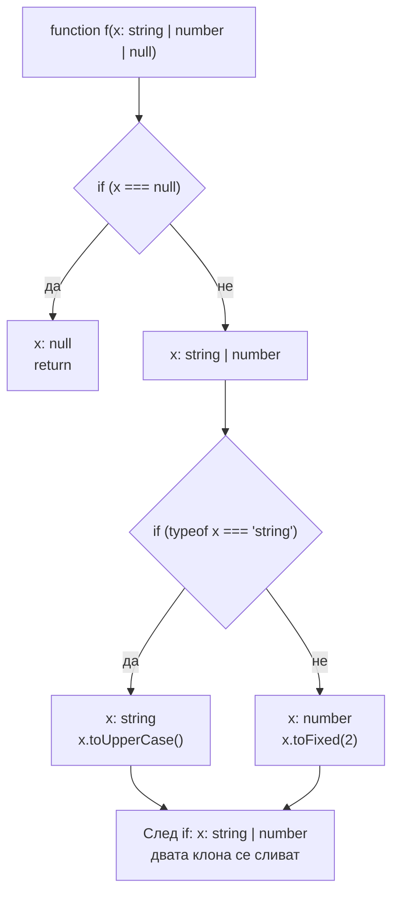

# Narrowing и control flow

Narrowing е стесняване на типа на променлива в даден клон на кода въз основа на проверка: след `if (typeof x === 'string')` вътре в блока `x` е `string`, а не `string | number`. Компилаторът следи всички пътища на изпълнение (control flow analysis) и във всяка точка знае най-тесния възможен тип. Това е механизмът, който прави union типовете използваеми.

## 1. За какво се ползва и защо ни е нужен

Union типовете (`string | null`, `Success | Failure`, `Circle | Square`) описват реални данни, но без narrowing не можеш да направиш нищо с тях: достъпни са само общите свойства. Narrowing позволява да пишеш нормален JavaScript с `if`, `switch` и `typeof`, а компилаторът сам да разбере какво е позволено във всеки клон.

Най-важният модел, който следва от това, е discriminated union: обекти с общо поле-литерал (`kind`, `type`, `status`), по което компилаторът различава вариантите. Това е стандартният начин да се моделират състояния, събития, отговори от API и Redux actions.

## 2. Как компилаторът следи типа



Компилаторът строи граф на control flow (в етапа binder) и за всяка употреба на променлива минава назад по графа, за да види какви проверки и присвоявания има по пътя. При сливане на клонове типовете се обединяват.

## 3. Начините за narrowing

| Проверка | Пример | Стеснява до |
|---|---|---|
| `typeof` | `typeof x === 'string'` | Примитив: `string`, `number`, `boolean`, `bigint`, `symbol`, `undefined`, `function`, `object` |
| Truthiness | `if (x)` | Маха `null`, `undefined`, но и `0`, `''`, `false` |
| Равенство | `x === null`, `x === 'a'` | Конкретен литерал или маха `null` |
| `in` | `'swim' in animal` | Вариантите на union, които имат свойството |
| `instanceof` | `err instanceof HttpError` | Класа (работи само с класове, не с interfaces) |
| Дискриминант | `shape.kind === 'circle'` | Варианта на discriminated union |
| Type guard | `isUser(x)` с `x is User` | Типа от предиката |
| Assertion function | `assertIsUser(x)` с `asserts x is User` | Типа, за останалия код след извикването |
| `Array.isArray` | `Array.isArray(x)` | `any[]` или масивната част на union |

## 4. Discriminated union

```ts state.ts
type RequestState<T> =
  | { status: 'idle' }
  | { status: 'loading' }
  | { status: 'success'; data: T }
  | { status: 'error'; error: Error };

function render(state: RequestState<string[]>): string {
  switch (state.status) {
    case 'idle':
      return 'Натисни бутона';
    case 'loading':
      return 'Зареждам...';
    case 'success':
      return state.data.join(', ');          // data е достъпно само тук
    case 'error':
      return state.error.message;            // error е достъпно само тук
    default: {
      const exhaustive: never = state;       // нов status без case е грешка тук
      return exhaustive;
    }
  }
}
```

Сравни с "плоския" вариант `{ loading: boolean; data?: T; error?: Error }`: той позволява невъзможни комбинации (`loading: true` и `error` едновременно) и всеки достъп до `data` изисква проверка. Discriminated union прави невалидните състояния непредставими.

## 5. Type guards и assertion functions

```ts guards.ts
interface User {
  id: string;
  email: string;
}

// Type guard: функцията връща boolean, а типът казва какво значи true
function isUser(value: unknown): value is User {
  return (
    typeof value === 'object' &&
    value !== null &&
    typeof (value as Record<string, unknown>).id === 'string' &&
    typeof (value as Record<string, unknown>).email === 'string'
  );
}

// Assertion function: хвърля, ако не е; след нея типът е стеснен
function assertIsUser(value: unknown): asserts value is User {
  if (!isUser(value)) throw new Error('not a user');
}

const data: unknown = JSON.parse('{"id":"1","email":"a@b.c"}');
if (isUser(data)) {
  data.email;            // User
}
assertIsUser(data);
data.id;                 // User до края на обхвата

// От TS 5.5 компилаторът извежда предиката сам за прости функции:
const ids = ['a', undefined, 'b'].filter((x) => x !== undefined);   // string[], не (string | undefined)[]
```

Внимание: компилаторът вярва на type guard-а. Ако функцията връща `true` грешно, типът лъже. Type guard е място, където трябва тест.

## 6. Кога narrowing се губи

```ts lost.ts
function example(value: string | null, getValue: () => string | null) {
  if (value !== null) {
    setTimeout(() => {
      value.length;          // ОК: параметърът не се преприсвоява никъде
    });
  }

  let mutable: string | null = getValue();
  if (mutable !== null) {
    [1, 2].forEach(() => {
      mutable.length;        // Грешка: 'mutable' is possibly 'null'
    });                      // callback-ът може да се изпълни по-късно, след ново присвояване
  }
  mutable = null;

  const obj: { name?: string } = {};
  if (obj.name) {
    doSomething();           // функция, която може да промени obj
    obj.name.length;         // ОК: TypeScript оптимистично пази стесняването за свойства
  }
}
declare function doSomething(): void;
```

Правилата: стесняването на `let`, който се преприсвоява след closure-а, не се пренася в callbacks. `const` и параметри, които не се преприсвояват, се пренасят (от TS 5.4). Стесняване на свойства на обект се пази оптимистично, дори да има извикване на функция, което теоретично може да ги промени.

## 7. Въпроси на интервю

### Какво е narrowing?

Стесняване на тип в рамките на клон от кода, въз основа на runtime проверка (`typeof`, `instanceof`, `in`, сравнение, type guard). Компилаторът прави control flow analysis и във всяка точка знае най-тесния тип на всяка променлива.

### Какво е discriminated union?

Union от обектни типове с общо свойство с литерален тип (дискриминант), например `kind: 'circle' | 'square'`. Проверката на дискриминанта стеснява целия обект до съответния вариант. Комбинирано с `never` в `default` дава проверка за изчерпателност при компилация.

### Каква е разликата между type guard и assertion function?

Type guard (`x is T`) връща boolean и стеснява типа в клона, където е `true`. Assertion function (`asserts x is T`) не връща нищо, а хвърля, ако условието не е изпълнено. След извикването ѝ типът е стеснен до края на обхвата.

### Защо `instanceof` не работи с interface?

Interface не съществува в runtime, така че няма с какво да се сравни. `instanceof` проверява прототипната верига на клас. За interfaces ползвай type guard, дискриминант или `in`.

### Как гарантираш, че `switch` обработва всички случаи?

В `default` присвояваш стойността на променлива от тип `never`. Ако всички варианти са обработени, стойността там е `never` и присвояването е валидно. Добавиш ли нов вариант, той стига до `default` и компилаторът дава грешка.

## 8. Капани и чести грешки

- Truthiness проверка за числа и низове: `if (count)` изключва `0`, `if (name)` изключва `''`.
- `typeof x === 'object'` пропуска, че `typeof null === 'object'`.
- Type guard, който проверява само едно поле, а обещава целия тип.
- Плоски обекти с опционални полета вместо discriminated union.
- `as` вместо narrowing: заглушава компилатора, без проверка.
- Очакване, че стесняване на `let` важи вътре в callback.

## 9. Свързани документи

- [any, unknown, never и йерархията](Type_Hierarchy.md)
- [Inference, widening, satisfies](Inference.md)
- [Runtime граница и валидация](Runtime_Boundary.md)
- [Conditional types и infer](Conditional_Types.md)
