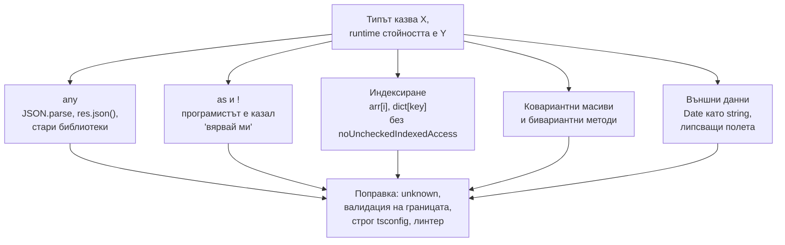

# Чести капани

TypeScript съзнателно не е напълно здрава (sound) типова система: на няколко места типовете казват едно, а runtime-ът прави друго. Повечето production бъгове в TypeScript код идват от няколко повтарящи се източника: `any`, който се разлива, `as` и `!`, индексиране без проверка, `Object.keys`, данни от JSON с грешен тип и забравени Promise. Тук са събрани на едно място, с причината и поправката.

## 1. За какво се ползва и защо ни е нужен

На интервю често дават код и питат "какво не е наред тук" или "защо това се компилира, а гърми". Знанието къде са дупките показва опит. В работа то спестява часове дебъг: когато типът "е правилен", а стойността е `undefined`, почти винаги е един от тези случаи.

## 2. Откъде идва несъответствието



## 3. Object.keys връща string[]

```ts object-keys.ts
interface Prices { basic: number; pro: number }
const prices: Prices = { basic: 10, pro: 30 };

for (const key of Object.keys(prices)) {
  prices[key];        // Грешка: string не може да индексира Prices
}
```

Причина: структурното типизиране позволява обект от тип `Prices` да има и други полета в runtime (виж [Структурно типизиране](Structural_Typing.md)). Ако `Object.keys` връщаше `('basic' | 'pro')[]`, това щеше да е лъжа. Решения: `Object.entries(prices)`, явен масив от ключовете (`const PLAN_KEYS = ['basic', 'pro'] as const`), или `as (keyof Prices)[]`, ако сам създаваш обекта и си сигурен.

## 4. Индексиране, което лъже

```ts indexing.ts
const users: Record<string, { name: string }> = {};
users['ana'].name;               // компилира се, гърми в runtime

const first = [1, 2, 3].find((n) => n > 5);
first.toFixed();                 // Грешка: find връща number | undefined (тук TS е прав)

const arr: number[] = [];
arr[0].toFixed();                // компилира се, гърми: arr[0] е undefined
```

Поправка: `noUncheckedIndexedAccess: true`. Тогава `users['ana']` и `arr[0]` са `T | undefined` и изискват проверка.

## 5. any, който се разлива

```ts any-leak.ts
function loadConfig() {
  return JSON.parse('{"port": "3000"}');    // any
}

const config = loadConfig();                 // any
const port: number = config.port;            // компилира се, но е низът "3000"
const next = port + 1;                       // "30001"
```

Поправка: `JSON.parse(text) as unknown` и валидация (виж [Runtime граница и валидация](Runtime_Boundary.md)). Правилото `@typescript-eslint/no-unsafe-*` хваща употреба на `any` стойности.

## 6. Non-null assertion и as

```ts assertions.ts
const el = document.querySelector('#total')!;     // ! казва "не е null"; ако е, гърми по-късно
el.textContent = '0';

const input = document.querySelector('#email') as HTMLInputElement;   // ако е <div>, input.value е undefined
```

`!` и `as` не проверяват нищо в runtime. Те преместват грешката по-далеч от причината. Поправка: явна проверка с ясно съобщение.

```ts assertions-fixed.ts
function mustGet<T extends Element>(selector: string, type: new () => T): T {
  const el = document.querySelector(selector);
  if (!(el instanceof type)) throw new Error(`${selector} не е ${type.name}`);
  return el;
}
const email = mustGet('#email', HTMLInputElement);   // HTMLInputElement, проверено
```

## 7. Optional срещу undefined

```ts optional.ts
interface A { value?: number }          // може да липсва
interface B { value: number | undefined }  // трябва да присъства, може да е undefined

const a: A = {};                        // ОК
const b: B = {};                        // Грешка: липсва value

// 'value' in a е false, 'value' in { value: undefined } е true:
// разликата има значение при spread, Object.keys и PATCH заявки
```

С `exactOptionalPropertyTypes: true` `value?: number` вече не приема изрично `undefined`, само липса. Това е важно при update операции, където "липсва" значи "не пипай", а `undefined` или `null` значи "изтрий".

## 8. Дати и други типове от JSON

```ts dates.ts
interface Order { id: string; createdAt: Date }

const order: Order = await (await fetch('/api/orders/1')).json();
order.createdAt.getTime();    // гърми: в JSON датата е низ, не Date
```

JSON няма `Date`, `Map`, `Set`, `bigint`, `undefined`. Типът на отговора трябва да описва JSON формата (`createdAt: string`), а конвертирането да е явно, например `z.coerce.date()` в схемата.

## 9. Забравен Promise

```ts floating.ts
async function save(): Promise<void> { /* ... */ }

function handler() {
  save();                      // компилира се: Promise-ът е изпуснат, грешката е unhandled
  if (isValid) { /* ... */ }
}

async function isValid(): Promise<boolean> { return false; }
if (isValid) { /* ... */ }    // функцията е truthy: условието винаги е вярно
```

TypeScript хваща второто (`This condition will always return true since this function is always defined`), когато функцията не е извикана никъде в блока. Първото не хваща. Правилото `@typescript-eslint/no-floating-promises` е задължително в Node проекти.

## 10. Въпроси на интервю

### Защо `Object.keys` не връща `(keyof T)[]`?

Защото типовете са структурни: стойност от тип `T` може да има допълнителни свойства в runtime. Ако `Object.keys` връщаше само познатите ключове, типът щеше да лъже за всеки обект с допълнителни полета.

### Здрава ли е типовата система на TypeScript?

Не напълно, по дизайн. Дупките са `any`, `as`, `!`, индексиране без `noUncheckedIndexedAccess`, ковариантни масиви, бивариантни методи. Целта е да е полезна за реален JavaScript, а не математически здрава.

### Каква е разликата между `prop?: T` и `prop: T | undefined`?

`prop?: T` значи, че свойството може да липсва изцяло. `prop: T | undefined` значи, че трябва да присъства, но стойността може да е `undefined`. Разликата се вижда с `in`, `Object.keys`, spread и при сериализация. С `exactOptionalPropertyTypes` `prop?: T` не приема изрично `undefined`.

### Какво не е наред с `const data: User = await res.json()`?

`res.json()` връща `any`, а анотацията само казва на компилатора да вярва. Няма проверка. Ако API-то върне грешка или друга форма, проблемът се появява далеч от тази линия. Трябва валидация със схема.

## 11. Капани накратко

| Капан | Поправка |
|---|---|
| `any` от JSON и библиотеки | `unknown` + валидация, `no-unsafe-*` правила |
| `as` и `!` | Проверка с ясна грешка |
| `arr[i]`, `dict[key]` | `noUncheckedIndexedAccess` |
| `Object.keys` | `Object.entries` или явен списък с ключове |
| `Date` в JSON типове | `string` в типа, явно конвертиране |
| Забравен `await` | `no-floating-promises` |
| `Omit` върху union | Дистрибутивен `Omit` |
| Методи в interface | Свойства с функционален тип |
| Числов `enum` | Union от литерали или `as const` обект |
| `{}` като тип "обект" | `object` или `Record<string, unknown>` |

## 12. Свързани документи

- [Runtime граница и валидация](Runtime_Boundary.md)
- [tsconfig и strict](Tsconfig.md)
- [Variance](Variance.md)
- [Структурно типизиране](Structural_Typing.md)
