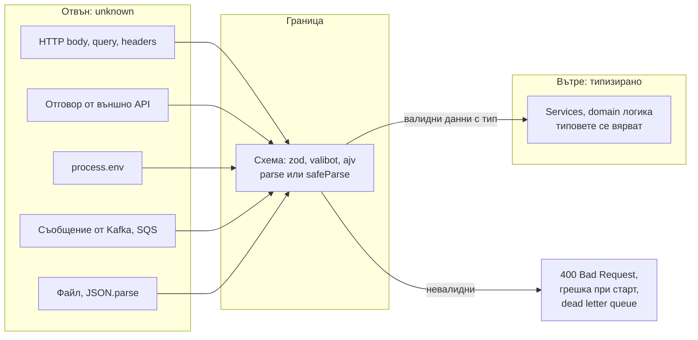

# Runtime граница и валидация

Типовете на TypeScript важат само за код, който компилаторът вижда. Всичко, което идва отвън (HTTP заявка, отговор от API, ред от базата, `JSON.parse`, променливи на средата, съобщение от опашка), е непроверено, каквото и да пише в анотацията. Правилото е: на границата данните са `unknown`, валидират се с код (обикновено със схема като zod), и чак тогава получават тип. Вътре в системата типовете вече могат да се вярват.

## 1. За какво се ползва и защо ни е нужен

Най-честата лъжа в TypeScript код е:

```ts lie.ts
interface User { id: string; email: string }
const user: User = await (await fetch('/api/me')).json();   // res.json() връща any
user.email.toLowerCase();    // компилира се; в runtime гърми, ако API-то върне { error: '...' }
```

Компилаторът не се оплаква, защото `res.json()` е `Promise<any>` и `any` се присвоява на всичко. Същото важи за `JSON.parse`, `req.body` в Express, `process.env` и `as User`. Грешката се появява далеч от мястото, където данните са влезли, и е трудна за проследяване.

Валидацията на границата дава:

- грешка на мястото на входа, с ясно съобщение кое поле е грешно;
- един източник на истината: схемата дава и runtime проверката, и TypeScript типа;
- защита от неочаквани полета (mass assignment) и от лоши данни, които стигат до базата.

## 2. Къде е границата



## 3. Минимален пример със zod

```ts validation.ts
import { z } from 'zod';                          // zod 4

// Схемата е източникът на истината
const CreateOrder = z.object({
  customerId: z.uuid(),
  items: z
    .array(z.object({ sku: z.string().min(1), qty: z.number().int().positive() }))
    .min(1),
  note: z.string().max(500).optional(),
});

// Типът се извежда от схемата: не се пише втори път
type CreateOrder = z.infer<typeof CreateOrder>;

// В handler-а: вход unknown, изход типизиран
export function handleCreateOrder(body: unknown) {
  const result = CreateOrder.safeParse(body);
  if (!result.success) {
    return { status: 400, errors: result.error.issues };   // кое поле е грешно и защо
  }
  const order: CreateOrder = result.data;                  // от тук нататък типът е истина
  return { status: 201, items: order.items.length };
}

// Променливи на средата: валидирай веднъж при старт, гръмни рано
const Env = z.object({
  DATABASE_URL: z.url(),
  PORT: z.coerce.number().int().default(3000),              // coerce: "3000" -> 3000
  NODE_ENV: z.enum(['development', 'production', 'test']),
});
export const env = Env.parse(process.env);                  // хвърля при липсваща или грешна стойност
```

## 4. Без библиотека: type guard

За малки и прости форми е достатъчен type guard (виж [Narrowing и control flow](Narrowing.md)). Минусът е, че типът и проверката са на две места и могат да се разминат.

```ts guard.ts
interface WebhookEvent { type: 'paid' | 'refunded'; orderId: string }

function isWebhookEvent(v: unknown): v is WebhookEvent {
  if (typeof v !== 'object' || v === null) return false;
  const o = v as Record<string, unknown>;
  return (o.type === 'paid' || o.type === 'refunded') && typeof o.orderId === 'string';
}
```

## 5. Грешки в catch

```ts catch.ts
async function load() {
  try {
    await fetch('https://example.com');
  } catch (err) {
    // err е unknown (useUnknownInCatchVariables, част от strict)
    // в JavaScript може да се хвърли всичко: низ, число, обект
    if (err instanceof Error) {
      console.error(err.message, err.cause);
    } else {
      console.error('Непозната грешка', err);
    }
  }
}
```

TypeScript не може да типизира какво хвърля функция (няма checked exceptions). Затова `catch` винаги получава `unknown`. Ако искаш грешките да са част от типа, ги връщаш като стойност:

```ts result.ts
type Result<T, E = Error> = { ok: true; value: T } | { ok: false; error: E };

function parsePort(raw: string): Result<number, 'NOT_A_NUMBER' | 'OUT_OF_RANGE'> {
  const n = Number(raw);
  if (!Number.isInteger(n)) return { ok: false, error: 'NOT_A_NUMBER' };
  if (n < 1 || n > 65535) return { ok: false, error: 'OUT_OF_RANGE' };
  return { ok: true, value: n };
}

const r = parsePort('8080');
if (r.ok) console.log(r.value);          // number
else console.log(r.error);               // 'NOT_A_NUMBER' | 'OUT_OF_RANGE'
```

## 6. Въпроси на интервю

### Валидира ли TypeScript данните от API?

Не. Типовете се изтриват при компилация, а `res.json()`, `JSON.parse` и `req.body` връщат `any`. Анотацията `const u: User = ...` само казва на компилатора да вярва. Данните отвън трябва да се валидират с runtime код, най-често със схема.

### Защо `unknown` на границата, а не `any`?

`any` изключва проверката и се разлива навътре: всичко, което докосне, става непроверено. `unknown` те принуждава да провериш, преди да ползваш. Така компилаторът гарантира, че невалидирани данни не стигат до логиката.

### Какво е `z.infer` и защо е полезен?

Утилити тип на zod, който извежда TypeScript типа от схемата. Схемата става единственият източник на истината: проверката в runtime и типът при компилация не могат да се разминат, защото са едно и също нещо.

### Какъв е типът на грешката в `catch`?

`unknown` при `strict` (флагът `useUnknownInCatchVariables`). В JavaScript може да се хвърли всяка стойност, не само `Error`, затова трябва `instanceof Error` или друга проверка преди достъп до `message`.

### Кога `as` е приемлив?

Когато знаеш нещо, което компилаторът не може да види, и си го проверил по друг начин: например след `document.querySelector` за елемент, който със сигурност съществува и е от конкретен тип, или при създаване на branded тип във валидираща функция. Никога за данни отвън без проверка.

## 7. Капани и чести грешки

- `const data: T = await res.json()` или `as T` без валидация.
- Generic HTTP клиент `get<T>(url): Promise<T>`, който изглежда безопасен, но е скрит `as T`.
- Типове за базата, написани на ръка и разминати със схемата. Генерирай ги (Prisma, Drizzle, Kysely codegen) или валидирай.
- `process.env.PORT` като `string | undefined`, използван като число без проверка.
- `err.message` в `catch` без проверка, че `err` е `Error`.
- Валидация, която пропуска непознати полета, а после целият обект се записва в базата (mass assignment). Схемите по подразбиране ги махат; провери настройката.

## 8. Свързани документи

- [Narrowing и control flow](Narrowing.md)
- [any, unknown, never и йерархията](Type_Hierarchy.md)
- [Компилаторът и type erasure](What_Is_TS.md)
- [Чести капани](Pitfalls.md)
