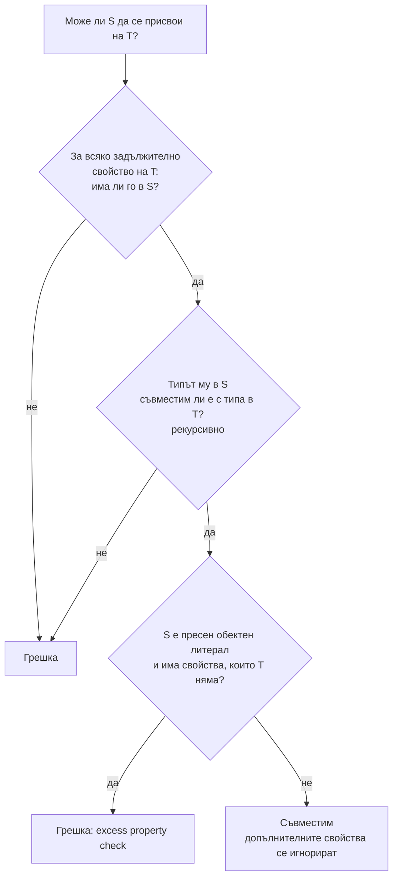

# Структурно типизиране

TypeScript сравнява типовете по форма, а не по име. Стойност е съвместима с тип, ако има всички свойства, които типът изисква, с подходящи типове. Няма значение как се казва типът, дали класът го имплементира явно, или че обектът има допълнителни свойства. Това се нарича структурно типизиране (или "duck typing на ниво компилатор"), за разлика от номиналното в Java и C#.

## 1. За какво се ползва и защо ни е нужен

TypeScript трябва да опише съществуващ JavaScript, а в JavaScript обектите се създават с литерали, сливат се и се подават навсякъде без класове. Номинална система би изисквала всеки обект да "декларира" какъв е, което е невъзможно за готов JS код.

Практическите последствия:

- Може да подадеш обект към функция, без да импортираш типа ѝ. Стига формата да съвпада.
- Mock в тестовете е просто обект с нужните методи, без `implements`.
- Два различни типа с еднаква форма са взаимозаменяеми, което понякога е бъг: `UserId` и `OrderId`, ако и двата са `string`. За това има branded типове.

## 2. Как се проверява съвместимост



Правилото е "поне толкова": S може да има повече свойства от T, но не по-малко. Повече свойства значи по-тесен (по-конкретен) тип. `{ name: string; age: number }` е подтип на `{ name: string }`.

## 3. Минимален пример

```ts structural.ts
interface Point {
  x: number;
  y: number;
}

class Vector {
  constructor(public x: number, public y: number, public z: number) {}
}

function length(p: Point): number {
  return Math.hypot(p.x, p.y);
}

length({ x: 3, y: 4 });            // ОК: точната форма
length(new Vector(3, 4, 5));       // ОК: Vector не "имплементира" Point, но има x и y

const p3 = { x: 1, y: 2, z: 3 };
length(p3);                        // ОК: допълнителното z се игнорира

length({ x: 1, y: 2, z: 3 });      // Грешка: excess property check за пресен литерал
```

## 4. Excess property check

Това е изключение от структурното правило. Когато подаваш **пресен обектен литерал** директно там, където се очаква тип, TypeScript гърми за непознати свойства. Причината е практическа: при литерал допълнително свойство почти винаги е печатна грешка (`colour` вместо `color`, `nmae` вместо `name`).

Проверката изчезва, щом литералът мине през променлива. Тогава важи нормалното структурно правило. Затова примерът с `p3` минава, а директният литерал не.

## 5. Branded (номинални) типове

Когато две стойности имат еднаква форма, но не бива да се смесват, добавяш фантомно свойство, което съществува само в типа:

```ts branded.ts
type Brand<T, B extends string> = T & { readonly __brand: B };

type UserId = Brand<string, 'UserId'>;
type OrderId = Brand<string, 'OrderId'>;

function getOrder(id: OrderId) { /* ... */ }

const userId = 'u_123' as UserId;          // единственото място с "as": при създаването
const orderId = 'o_456' as OrderId;

getOrder(orderId);                         // ОК
getOrder(userId);                          // Грешка: UserId не е OrderId
getOrder('o_789');                         // Грешка: обикновен string не е OrderId
```

В runtime `userId` е обикновен низ. Brand-ът е само за компилатора. Обикновено се създава от функция, която валидира (`parseOrderId(raw): OrderId`), така че `as` е на едно място.

## 6. Класове и структурата

Класовете също се сравняват структурно, с едно изключение: `private` и `protected` членове. Ако клас има `private` поле, само инстанции на този клас (или наследници) са съвместими с него, дори друг клас да има поле със същото име. Това е начин да получиш номинално поведение.

## 7. Въпроси на интервю

### Какво е структурно типизиране?

Съвместимостта се определя от формата на типа (какви свойства има и от какъв тип са), а не от името му или от явна декларация (`implements`, `extends`). Ако обект има всички изисквани свойства, той е съвместим.

### Каква е разликата с номиналното типизиране?

При номиналното (Java, C#) два класа с идентични полета са несъвместими, ако нямат обща йерархия. Типът се идентифицира по име. При структурното същите два типа са взаимозаменяеми. TypeScript избира структурното, защото описва JavaScript, където обектите нямат "име".

### Защо `const x = {a: 1, b: 2}; f(x)` минава, а `f({a: 1, b: 2})` не, ако `f` приема `{a: number}`?

Excess property check важи само за пресни обектни литерали, подадени директно. Целта е да хване печатни грешки. Когато стойността идва от променлива, TypeScript приема, че допълнителните свойства са нарочни, и прилага нормалното структурно правило.

### Как да направиш два string типа несъвместими?

С branded тип: `type UserId = string & { readonly __brand: 'UserId' }`. Brand свойството не съществува в runtime, но прави типовете различни за компилатора. Създаването става с `as` в една валидираща функция.

### Съвместим ли е `{}` с всичко?

Типът `{}` означава "всяка стойност, която не е `null` или `undefined`". Затова `const x: {} = 42` е валидно. Ако искаш "обект без свойства", ползвай `Record<string, never>`. Ако искаш "произволен обект", ползвай `object` или `Record<string, unknown>`.

## 8. Капани и чести грешки

- Смесване на идентификатори от един базов тип (`userId` подаден вместо `orderId`). Branded типове.
- Изненада, че обект с "излишни" полета минава проверката. Структурното правило го позволява.
- Очакване на excess property check през променлива.
- `{}` или `Object` като тип за "обект": приемат и числа, и низове.
- Подаване на обект с допълнителни полета към функция, която го сериализира (`JSON.stringify`) или записва в базата. Типът не маха полетата: паролата може да изтече в отговора.

## 9. Свързани документи

- [any, unknown, never и йерархията](Type_Hierarchy.md)
- [type срещу interface](Type_vs_Interface.md)
- [Variance](Variance.md)
- [Класове](Classes.md)
