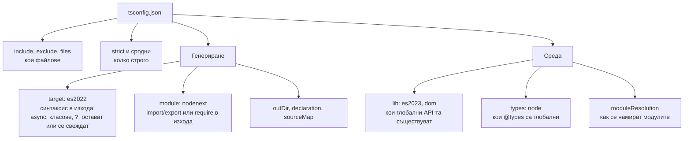

# tsconfig и strict

`tsconfig.json` казва на компилатора кои файлове са част от проекта, колко строго да проверява и какъв JavaScript да генерира. Най-важният флаг е `strict`: група от проверки, без които TypeScript пропуска голяма част от реалните бъгове (`null`, неявни `any`, грешни callbacks). От TypeScript 6.0 `strict` е включен по подразбиране. Отделно три групи настройки често се бъркат: `target` (до какъв синтаксис се свежда кодът), `lib` (кои вградени API-та съществуват) и `module` (какви import-и се генерират и как се търсят модулите).

## 1. За какво се ползва и защо ни е нужен

Един и същ код дава различни грешки при различни настройки. На интервю питат какво включва `strict`, защо `strictNullChecks` е най-важният флаг и какво прави `noUncheckedIndexedAccess`. В работа грешна комбинация от `target`, `lib` и `module` дава код, който се компилира, но гърми в runtime (`structuredClone is not defined`, `Cannot use import statement outside a module`).

## 2. Какво контролира кое



| Настройка | Отговаря на въпроса | Типична стойност за Node backend |
|---|---|---|
| `target` | Какъв синтаксис да остане в изхода? | `es2022` или по-нова (Node 20+ поддържа всичко) |
| `lib` | Какви API-та има в средата? | По подразбиране следва `target`. Без `dom` за backend |
| `module` | Какъв модулен формат да генерира? | `nodenext` |
| `moduleResolution` | Как да намира модулите? | `nodenext` (следва от `module`) |
| `types` | Кои `@types` пакети да са глобални? | `["node"]` |

`target` не добавя polyfills. Ако `lib` казва, че `Array.prototype.at` съществува, а средата е стара, кодът се компилира и гърми.

## 3. Какво включва strict

| Флаг | Какво хваща |
|---|---|
| `strictNullChecks` | `null` и `undefined` не са част от всеки тип. Без него `string` приема `null` и половината проверки са безсмислени |
| `noImplicitAny` | Параметри и променливи без тип и без извеждане са грешка, а не тихо `any` |
| `strictFunctionTypes` | Контравариантна проверка на параметрите на функционални типове (виж [Variance](Variance.md)) |
| `strictBindCallApply` | Типизирани `bind`, `call`, `apply` |
| `strictPropertyInitialization` | Поле на клас, което не е инициализирано в конструктора, е грешка |
| `noImplicitThis` | `this` с неявен тип `any` е грешка |
| `useUnknownInCatchVariables` | `catch (e)` е `unknown`, не `any` |
| `alwaysStrict` | `"use strict"` във всеки файл |

`strict: true` включва всички тях, а и бъдещите, които се добавят към групата. Затова ъпгрейд на TypeScript понякога дава нови грешки.

## 4. Извън strict, но силно препоръчителни

```ts extra-flags.ts
// noUncheckedIndexedAccess: индексиране добавя "| undefined"
const users: Record<string, { name: string }> = {};
const u = users['ana'];              // без флага: { name: string }; с флага: { name: string } | undefined
u.name;                              // с флага: Грешка, трябва проверка

const arr = [1, 2, 3];
const x = arr[10];                   // без флага: number (лъже); с флага: number | undefined

// exactOptionalPropertyTypes: "?" значи "може да липсва", не "може да е undefined"
interface Options { timeout?: number }
const o: Options = { timeout: undefined };   // с флага: Грешка

// noImplicitOverride: задължителен override при презаписване на метод
// noFallthroughCasesInSwitch: case без break или return е грешка
// noPropertyAccessFromIndexSignature: obj.key за индексна сигнатура изисква obj['key']
```

## 5. Минимален пример: tsconfig за Node backend

```json tsconfig.json
{
  "compilerOptions": {
    "target": "es2023",
    "module": "nodenext",
    "moduleResolution": "nodenext",
    "lib": ["es2023"],
    "types": ["node"],

    "strict": true,
    "noUncheckedIndexedAccess": true,
    "exactOptionalPropertyTypes": true,
    "noImplicitOverride": true,
    "noFallthroughCasesInSwitch": true,

    "verbatimModuleSyntax": true,
    "isolatedModules": true,
    "erasableSyntaxOnly": true,
    "skipLibCheck": true,

    "rootDir": "src",
    "outDir": "dist",
    "sourceMap": true,
    "declaration": false
  },
  "include": ["src"]
}
```

| Флаг | Защо |
|---|---|
| `verbatimModuleSyntax` | `import type` се изтрива, всичко останало остава както е написано. Предвидимо поведение |
| `isolatedModules` | Гарантира, че всеки файл може да се компилира сам (esbuild, swc, Node) |
| `erasableSyntaxOnly` | Забранява enums, namespaces и parameter properties, за да може кодът да се изпълни с type stripping |
| `skipLibCheck` | Не проверява `.d.ts` файловете в `node_modules`. Много по-бърза компилация |

`tsc --init` в TypeScript 6 генерира съвременна конфигурация с повечето от тези флагове.

## 6. Въпроси на интервю

### Какво включва `strict`?

Група флагове: `strictNullChecks`, `noImplicitAny`, `strictFunctionTypes`, `strictBindCallApply`, `strictPropertyInitialization`, `noImplicitThis`, `useUnknownInCatchVariables`, `alwaysStrict`. Включването на `strict` включва всички, а нови проверки се добавят към групата с новите версии. От TypeScript 6.0 е включен по подразбиране.

### Кой strict флаг е най-важен и защо?

`strictNullChecks`. Без него `null` и `undefined` са част от всеки тип, така че компилаторът не хваща най-честата runtime грешка: `Cannot read properties of undefined`. С него `string | null` трябва да се провери, преди да се ползва.

### Какво прави `noUncheckedIndexedAccess`?

Добавя `| undefined` към резултата от индексиране по индексна сигнатура или масив (`arr[i]`, `dict[key]`). Без него TypeScript приема, че елементът винаги съществува. Не е част от `strict`, защото изисква много проверки в съществуващ код, но в нов код е силно препоръчителен.

### Каква е разликата между `target` и `lib`?

`target` определя какъв синтаксис остава в генерирания JavaScript (дали `async/await` и класовете се свеждат до по-стар код). `lib` определя кои вградени API-та компилаторът смята за налични (`Promise`, `Array.prototype.at`, DOM). Нито едното не добавя polyfills.

### Как мигрираш стар проект към strict?

Постепенно: включваш флаговете един по един, започвайки от `noImplicitAny` и `strictNullChecks`. Или включваш `strict` и маркираш съществуващите грешки, като ги поправяш по модули. Инструменти като `ts-strict-plugin` позволяват strict само за нови или избрани файлове.

## 7. Капани и чести грешки

- `lib: ["dom"]` в backend проект: `fetch`, `window` и `document` изглеждат налични там, където не са.
- Изключен `strict` "временно" в нов проект.
- `skipLibCheck: false` в голям проект: бавна компилация заради чужди типове.
- `module: commonjs` с `"type": "module"` в `package.json`: изходът не съответства на начина, по който Node зарежда файла.
- Различни tsconfig за редактора и за CI, които дават различни грешки.

## 8. Свързани документи

- [Модули и .d.ts файлове](Modules_Declarations.md)
- [Build и производителност](Build_Tooling.md)
- [Чести капани](Pitfalls.md)
- [Variance](Variance.md)
