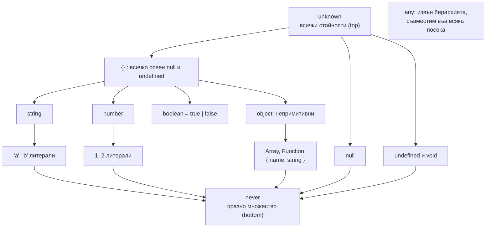
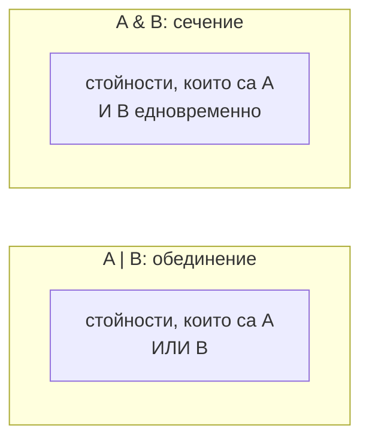

# any, unknown, never и йерархията

Най-полезният модел за типовете в TypeScript е множеството: всеки тип е множество от възможни стойности. `string` е множеството на всички низове, литералът `'a'` е множество с един елемент, `unknown` съдържа всички стойности (top тип), а `never` не съдържа нито една (bottom тип). Union (`A | B`) е обединение на множества, intersection (`A & B`) е сечение. `any` стои извън модела: изключва проверката.

## 1. За какво се ползва и защо ни е нужен

С модела на множествата повечето "странни" поведения стават очевидни:

- защо `string & number` е `never` (няма стойност, която е и двете);
- защо `{ a: string } & { b: number }` е обект с двете полета (сечение на множества значи стойности, които отговарят на двете условия);
- защо `never` се присвоява на всичко (празното множество е подмножество на всяко);
- защо `unknown` не може да се ползва без проверка (може да е всичко).

На интервю почти винаги питат за разликата между `any` и `unknown` и за употребата на `never`.

## 2. Йерархията



Стрелката значи "съдържа". Стойност от по-долен тип може да се присвои на по-горен (`'a'` на `string`, `string` на `unknown`). Обратното изисква проверка.

## 3. Четирите специални типа

| Тип | Множество | Присвояване към него | Употреба на стойността | Кога |
|---|---|---|---|---|
| `unknown` | Всички стойности | Всичко може | Нищо без narrowing | Вход отвън, `catch (e)`, generic без ограничение |
| `any` | "Не проверявай" | Всичко може | Всичко може, без проверка | Миграция от JS, рядко и локално |
| `never` | Празно | Само `never` | Присвоява се на всичко | Невъзможни случаи, функции, които не връщат |
| `void` | `undefined` (за return) | `undefined` | Не се ползва | Return тип на функция без резултат |

### any срещу unknown

```ts any-unknown.ts
function withAny(x: any) {
  x.foo.bar();          // компилира се, гърми в runtime
  const n: number = x;  // компилира се: any се "разлива" навсякъде
}

function withUnknown(x: unknown) {
  x.foo;                // Грешка: 'x' is of type 'unknown'
  const n: number = x;  // Грешка
  if (typeof x === 'number') {
    const m: number = x; // ОК: след проверката x е number
  }
}
```

`any` изключва проверката и се разпространява: всичко, до което се допре, също става `any`. `unknown` е безопасният вариант: приема всичко, но те принуждава да провериш, преди да ползваш.

### never

`never` има три основни употреби:

```ts never.ts
// 1. Функция, която никога не връща нормално
function fail(message: string): never {
  throw new Error(message);
}

// 2. Проверка за изчерпателност: компилаторът гарантира, че всички случаи са обработени
type Shape = { kind: 'circle'; r: number } | { kind: 'square'; side: number };

function area(s: Shape): number {
  switch (s.kind) {
    case 'circle': return Math.PI * s.r ** 2;
    case 'square': return s.side ** 2;
    default: {
      const unreachable: never = s;   // ако добавиш 'triangle', тук става грешка
      return unreachable;
    }
  }
}

// 3. Филтриране в conditional types: never изчезва от union
type NonNull<T> = T extends null | undefined ? never : T;
type A = NonNull<string | null>;   // string
```

## 4. Union и intersection



| Израз | Резултат | Защо |
|---|---|---|
| `string \| number` | Низ или число | Обединение |
| `string & number` | `never` | Няма стойност, която е и двете |
| `{ a: string } & { b: number }` | `{ a: string; b: number }` | Обектите, които имат и `a`, и `b` |
| `{ a: string } \| { b: number }` | Едното или другото | Без проверка достъпни са само общите свойства |
| `'a' \| string` | `string` | `'a'` вече е в `string` |
| `T \| never` | `T` | Празното множество не добавя нищо |
| `T & unknown` | `T` | `unknown` е всичко |

Контраинтуитивното: при обекти `&` дава повече свойства, а `|` дава по-малко достъпни свойства. Защото повече изисквания значи по-малко множество от стойности.

## 5. Въпроси на интервю

### Каква е разликата между `any` и `unknown`?

И двата приемат всяка стойност. `any` изключва проверката: можеш да викаш методи, да достъпваш полета и да го присвоиш на всеки тип, без грешка. `unknown` изисква narrowing (`typeof`, `instanceof`, type guard), преди да ползваш стойността. `unknown` е безопасният избор за данни с неизвестна форма.

### Какво е `never` и за какво се ползва?

Типът без стойности, bottom на йерархията. Return тип на функции, които винаги хвърлят или безкраен цикъл. Проверка за изчерпателност в `switch` по discriminated union. В conditional types служи за премахване на членове от union.

### Каква е разликата между `void` и `undefined`?

`undefined` е конкретна стойност и тип. `void` като return тип значи "резултатът не трябва да се ползва". Особеност: функционален тип с `void` return приема функции, които връщат нещо (`arr.forEach(x => list.push(x))` е валидно, въпреки че `push` връща число). При декларация на функция с `: void` обаче не можеш да върнеш стойност.

### Каква е разликата между `object`, `Object` и `{}`?

`object` е всяка непримитивна стойност (обекти, масиви, функции). `{}` и `Object` са всяка стойност освен `null` и `undefined`, включително примитиви. За "произволен обект" ползвай `object` или `Record<string, unknown>`.

### Защо `string & number` е `never`?

Защото intersection е сечение на множествата, а няма стойност, която е едновременно низ и число. Сечението на непресичащи се множества е празното множество.

## 6. Капани и чести грешки

- `any` от `JSON.parse`, `res.json()` или стари библиотеки, който тихо "заразява" кода. Обвивай в `unknown` и валидирай.
- `as any` за заглушаване на грешка. Почти винаги има по-точно решение.
- Очакване, че `A | B` дава достъп до всички свойства на двата типа. Достъпни са само общите, докато не направиш narrowing.
- `{}` като тип за "обект".
- Изпускане на `default` с `never` проверка: нов случай в union не се хваща от компилатора.

## 7. Свързани документи

- [Narrowing и control flow](Narrowing.md)
- [Структурно типизиране](Structural_Typing.md)
- [Conditional types и infer](Conditional_Types.md)
- [Runtime граница и валидация](Runtime_Boundary.md)
