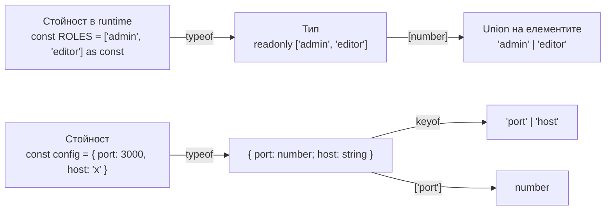

# keyof, typeof, indexed access

Три оператора позволяват да изведеш типове от други типове и от стойности, вместо да ги пишеш наново. `keyof T` дава union от имената на свойствата на `T`. `typeof x` в типова позиция дава типа на стойността `x`. Indexed access `T['name']` дава типа на конкретно свойство, а `T[number]` дава типа на елементите на масив или tuple. Заедно те държат типовете синхронизирани с кода: една промяна на едно място.

## 1. За какво се ползва и защо ни е нужен

Дублирането на типове е източник на бъгове: добавиш роля в масива с роли, но забравиш да я добавиш в типа. С тези оператори единственият източник на истината е стойността или основният тип, а всичко останало се извежда:

- union от константен масив (`'admin' | 'editor' | 'viewer'` от `ROLES`);
- тип на конфигурация от обекта с конфигурацията;
- тип на поле от голям тип, без да го повтаряш (`User['address']`);
- типобезопасни функции като `get(obj, key)`.

## 2. Как се свързват



## 3. Трите оператора

| Оператор | Работи върху | Резултат | Пример |
|---|---|---|---|
| `keyof T` | Тип | Union от ключовете | `keyof { a: 1; b: 2 }` е `'a' \| 'b'` |
| `typeof x` | Стойност (в типова позиция) | Типа на стойността | `typeof config` |
| `T[K]` | Тип и ключ | Типа на свойството | `User['email']` е `string` |
| `T[number]` | Масив или tuple | Типа на елементите | `string[][number]` е `string` |
| `T[K1 \| K2]` | Тип и union от ключове | Union от типовете | `User['id' \| 'age']` е `string \| number` |

`typeof` в типова позиция е различен от JavaScript `typeof` в израз. `type C = typeof config` е типов оператор. `if (typeof x === 'string')` е runtime проверка.

## 4. Минимален пример

```ts operators.ts
// 1. Union от константен масив: единственият източник на истината е масивът
export const ROLES = ['admin', 'editor', 'viewer'] as const;
export type Role = (typeof ROLES)[number];                 // 'admin' | 'editor' | 'viewer'

function isRole(value: string): value is Role {
  return (ROLES as readonly string[]).includes(value);     // runtime проверка от същия масив
}

// 2. Тип от обект
const defaults = { port: 3000, host: 'localhost', debug: false };
type Config = typeof defaults;                             // { port: number; host: string; debug: boolean }
type ConfigKey = keyof Config;                             // 'port' | 'host' | 'debug'

// 3. Типобезопасен getter
function get<T, K extends keyof T>(obj: T, key: K): T[K] {
  return obj[key];
}
const port = get(defaults, 'port');                        // number
const dbg = get(defaults, 'debug');                        // boolean

// 4. Indexed access в дълбочина
interface Order {
  id: string;
  customer: { name: string; address: { city: string; zip: string } };
  items: { sku: string; qty: number }[];
}
type Address = Order['customer']['address'];               // { city: string; zip: string }
type Item = Order['items'][number];                        // { sku: string; qty: number }

// 5. Типът на return стойността на функция
function createUser(name: string) {
  return { id: crypto.randomUUID(), name, createdAt: new Date() };
}
type CreatedUser = ReturnType<typeof createUser>;          // { id: string; name: string; createdAt: Date }
```

## 5. keyof и индексни сигнатури

```ts keyof-index.ts
type Dict = { [key: string]: number };
type K1 = keyof Dict;          // string | number (JS превръща числовите ключове в низове)

type Arr = keyof string[];     // number | "length" | "push" | ... всички методи на масив

type Obj = keyof {};           // never: празен обект няма ключове
```

`keyof` на тип с `string` индексна сигнатура включва и `number`, защото `obj[0]` и `obj['0']` са едно и също в JavaScript.

## 6. Въпроси на интервю

### Как извеждаш union тип от масив със стойности?

`const ROLES = ['a', 'b'] as const; type Role = (typeof ROLES)[number]`. `as const` прави масива readonly tuple с литерални типове, `typeof` взема типа му, `[number]` дава union от елементите. Масивът остава в runtime за проверки, а типът се обновява автоматично.

### Каква е разликата между `typeof` в TypeScript и в JavaScript?

В израз (`typeof x === 'string'`) е JavaScript операторът, връща низ в runtime и стеснява типа. В типова позиция (`type T = typeof x`) е типов оператор, който взема статичния тип на стойността и изчезва при компилация.

### Какво връща `keyof` на union и на intersection?

`keyof (A | B)` дава само общите ключове (свойствата, които със сигурност съществуват). `keyof (A & B)` дава всички ключове от двата. Логиката е обратна на интуицията, но следва от модела на множествата: union има по-малко гарантирани свойства.

### Как напишеш типобезопасен `get(obj, key)`?

`function get<T, K extends keyof T>(obj: T, key: K): T[K]`. `K` е ограничено до ключовете на `T`, а return типът е indexed access към конкретния ключ.

## 7. Капани и чести грешки

- Забравен `as const`: `typeof ROLES[number]` дава `string`.
- `keyof typeof obj` за обект с индексна сигнатура: получаваш `string | number`, не конкретните ключове.
- Очакване, че `Object.keys(obj)` връща `(keyof T)[]`. Връща `string[]`, виж [Чести капани](Pitfalls.md).
- `typeof` върху тип: `typeof User`, когато `User` е interface, е грешка. `typeof` работи само върху стойности.
- Индексиране с ключ, който не е литерал: `T[string]` работи само ако `T` има индексна сигнатура.

## 8. Свързани документи

- [Generics](Generics.md)
- [Mapped и template literal типове](Mapped_Types.md)
- [Utility types отвътре](Utility_Types.md)
- [Inference, widening, satisfies](Inference.md)
