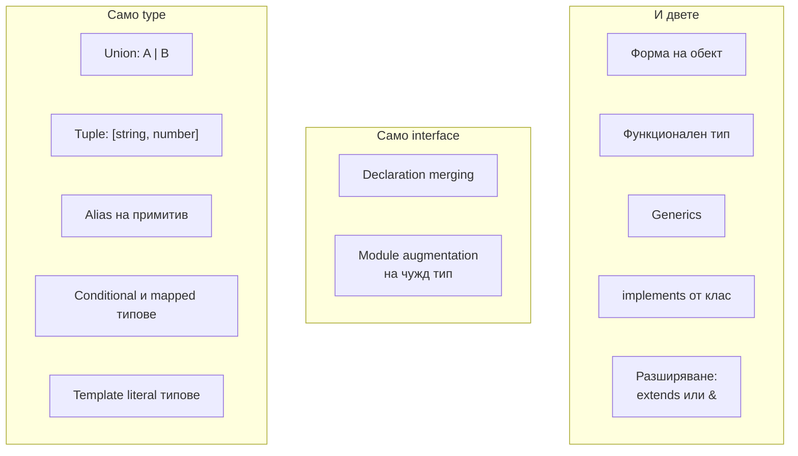

# type срещу interface

`interface` и `type` alias описват формата на обекти почти еднакво. Разликите са в краищата: `interface` може да се декларира няколко пъти и декларациите се сливат (declaration merging), и наследява с `extends`. `type` може да именува всеки тип, не само обекти: union, tuple, примитив, conditional и mapped типове. За обекти изборът е най-вече въпрос на конвенция в екипа.

## 1. За какво се ползва и защо ни е нужен

Въпросът "type или interface" е класически, защото проверява дали знаеш реалните разлики, а не мненията. Практическите следствия:

- **Библиотеки** често дават `interface`, за да може потребителят да го разшири (например да добави поле към `Request` в Express или към `Window` в браузъра).
- **Union и типове върху типове** (`'a' | 'b'`, `Partial<T>`, conditional) са възможни само с `type`.
- **Конфликтни полета** при наследяване: `extends` дава грешка на мястото на декларацията, а `&` тихо дава `never` за полето.

## 2. Какво може всеки



| | `interface` | `type` |
|---|---|---|
| Обектна форма | Да | Да |
| Union, tuple, примитив | Не | Да |
| Mapped и conditional | Не | Да |
| Declaration merging | Да | Не: дублирано име е грешка |
| Наследяване | `extends`, проверява конфликти | `&`, конфликтите стават `never` |
| Име в съобщенията за грешки | Винаги по име | Понякога разгънат |
| `implements` от клас | Да | Да, ако е обектен тип |

## 3. Declaration merging

```ts merging.ts
interface Config {
  port: number;
}
interface Config {
  host: string;          // втората декларация се слива с първата
}

const c: Config = { port: 3000, host: 'localhost' };   // и двете полета са задължителни

type Settings = { port: number };
type Settings = { host: string };   // Грешка: Duplicate identifier 'Settings'
```

Най-полезната употреба е разширяване на типове от библиотека:

```ts express.d.ts
import 'express';

declare module 'express-serve-static-core' {
  interface Request {
    user?: { id: string; roles: string[] };   // вече съществува в req.user навсякъде
  }
}
```

Рискът: случайно сливане. Ако в два файла има глобален `interface User`, те се сливат тихо.

## 4. extends срещу &

```ts extends.ts
interface A { id: string }
interface B extends A { id: number }    // Грешка тук: 'id' е несъвместим

type C = { id: string };
type D = C & { id: number };            // няма грешка...
const d: D = { id: 1 };                 // ...но тук: id е string & number = never
```

`extends` проверява съвместимостта на мястото на декларацията и дава ясна грешка. `&` комбинира без проверка и проблемът се появява по-късно, на неочаквано място. Освен това компилаторът кешира отношенията между interfaces по име, което прави големи йерархии с `extends` по-бързи за проверка от дълги вериги от `&`.

## 5. Минимален пример: кога кое

```ts choice.ts
// Обект, който може да се разширява: interface
interface User {
  id: string;
  email: string;
}

interface Admin extends User {
  permissions: string[];
}

// Union и други не-обектни типове: само type
type Status = 'active' | 'blocked' | 'deleted';
type Result<T> = { ok: true; value: T } | { ok: false; error: string };
type Pair = [key: string, value: number];
type UserPatch = Partial<Omit<User, 'id'>>;
```

Разумна конвенция: `interface` за обектни форми (особено публични API-та), `type` за всичко останало. Друга често срещана: `type` навсякъде, за еднообразие. И двете са валидни, важното е последователността.

## 6. Въпроси на интервю

### Каква е разликата между `type` и `interface`?

`interface` описва само обектни форми, поддържа declaration merging и наследява с `extends`, като проверява конфликтите. `type` може да именува всеки тип: union, tuple, примитив, conditional, mapped, template literal. Не се слива: дублирано име е грешка. За обикновени обекти двете са взаимозаменяеми.

### Кога би избрал `interface`?

За публични обектни API-та, които потребителите може да искат да разширят, за класови договори (`implements`) и за дълбоки йерархии, където `extends` дава по-ясни грешки и по-бърза проверка.

### Кога задължително трябва `type`?

За union (`'a' | 'b'`), tuple, alias на примитив или функция, и за всякакви типове, изградени от други: `Partial<T>`, `keyof T`, conditional и mapped типове.

### Какво е declaration merging?

Няколко декларации на `interface` със същото име в един обхват се сливат в една. Ползва се за разширяване на типове от библиотеки (module augmentation) и глобални типове. `namespace`, `enum` и `class` също участват в сливане по определени правила.

## 7. Капани и чести грешки

- Неочаквано сливане на два глобални `interface` със същото име.
- `&` с конфликтни полета, което тихо дава `never`.
- Дълги вериги от `&` в големи проекти: по-бавна проверка и нечетими грешки.
- Опит за union с `interface`.
- Безкрайни спорове в code review. Избери конвенция и я запиши в линтера (`@typescript-eslint/consistent-type-definitions`).

## 8. Свързани документи

- [Структурно типизиране](Structural_Typing.md)
- [Модули и .d.ts файлове](Modules_Declarations.md)
- [Mapped и template literal типове](Mapped_Types.md)
- [Класове](Classes.md)
