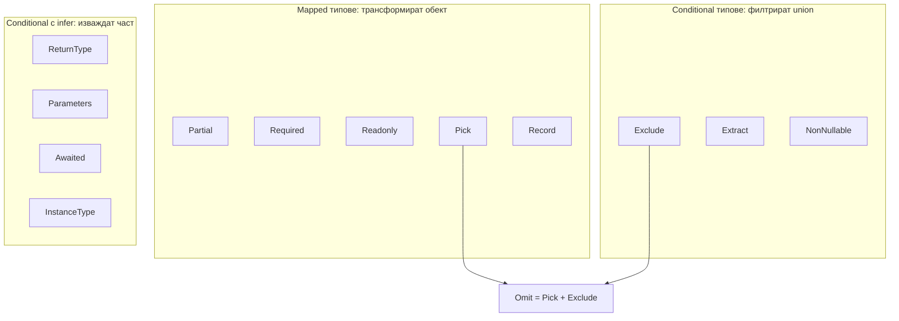

# Utility types отвътре

Utility types са готовите generic типове в стандартната библиотека на TypeScript (`lib.es5.d.ts` и сродни): `Partial`, `Pick`, `Omit`, `Record`, `ReturnType`, `Awaited` и още. Те не са магия на компилатора, а обикновени mapped и conditional типове от по един-два реда. Да знаеш как са написани е най-бързият начин да покажеш, че разбираш типовата система, и чест интервю въпрос: "напиши `Pick` сам".

## 1. За какво се ползва и защо ни е нужен

Utility types позволяват да изведеш производни типове от един основен, вместо да ги дублираш:

- `CreateUserDto = Omit<User, 'id' | 'createdAt'>`;
- `UpdateUserDto = Partial<CreateUserDto>`;
- `UserPreview = Pick<User, 'id' | 'name'>`;
- `Handlers = Record<EventName, () => void>`;
- `Props = Parameters<typeof Component>[0]`, когато библиотека не експортира типа.

Когато основният тип се промени, всички производни се обновяват.

## 2. Как са свързани



## 3. Имплементациите

```ts utility.ts
// ---- Mapped ----
type MyPartial<T> = { [P in keyof T]?: T[P] };
type MyRequired<T> = { [P in keyof T]-?: T[P] };
type MyReadonly<T> = { readonly [P in keyof T]: T[P] };
type MyPick<T, K extends keyof T> = { [P in K]: T[P] };
type MyRecord<K extends keyof any, V> = { [P in K]: V };   // keyof any = string | number | symbol

// ---- Conditional (дистрибутивни) ----
type MyExclude<T, U> = T extends U ? never : T;
type MyExtract<T, U> = T extends U ? T : never;
type MyNonNullable<T> = T & {};                              // съвременната дефиниция: {} изключва null и undefined

// ---- Комбинация ----
type MyOmit<T, K extends keyof any> = MyPick<T, MyExclude<keyof T, K>>;

// ---- С infer ----
type MyReturnType<T extends (...args: any) => any> = T extends (...args: any) => infer R ? R : any;
type MyParameters<T extends (...args: any) => any> = T extends (...args: infer P) => any ? P : never;
type MyInstanceType<T extends abstract new (...args: any) => any> =
  T extends abstract new (...args: any) => infer R ? R : any;

// ---- Рекурсивно ----
type MyAwaited<T> = T extends null | undefined
  ? T
  : T extends object & { then(onfulfilled: infer F, ...args: infer _): any }
    ? F extends (value: infer V, ...args: infer _) => any
      ? MyAwaited<V>
      : never
    : T;
```

`Awaited` е сложен, защото трябва да работи с всеки thenable, не само с `Promise`, и да разопакова рекурсивно, точно както прави `await` в runtime.

## 4. Минимален пример: DTO от един тип

```ts dto.ts
interface User {
  id: string;
  email: string;
  name: string;
  passwordHash: string;
  createdAt: Date;
}

type CreateUserInput = Omit<User, 'id' | 'createdAt' | 'passwordHash'> & { password: string };
type UpdateUserInput = Partial<Omit<CreateUserInput, 'email'>>;
type PublicUser = Omit<User, 'passwordHash'>;
type UserListItem = Pick<User, 'id' | 'name'>;

async function findUser(id: string): Promise<User | null> { return null; }
type FoundUser = Awaited<ReturnType<typeof findUser>>;          // User | null
type FindArgs = Parameters<typeof findUser>;                     // [id: string]

const byRole: Record<'admin' | 'editor', UserListItem[]> = { admin: [], editor: [] };
```

## 5. Таблица

| Тип | Какво прави | Вид |
|---|---|---|
| `Partial<T>` | Всички полета опционални | Mapped |
| `Required<T>` | Всички полета задължителни | Mapped |
| `Readonly<T>` | Всички полета readonly (плитко) | Mapped |
| `Pick<T, K>` | Само избраните ключове | Mapped |
| `Omit<T, K>` | Без избраните ключове | Pick + Exclude |
| `Record<K, V>` | Обект с ключове `K` и стойности `V` | Mapped |
| `Exclude<U, X>` | Маха от union членовете, съвместими с `X` | Conditional |
| `Extract<U, X>` | Оставя от union членовете, съвместими с `X` | Conditional |
| `NonNullable<T>` | Маха `null` и `undefined` | Intersection с `{}` |
| `ReturnType<F>` | Return тип на функция | infer |
| `Parameters<F>` | Tuple от параметрите | infer |
| `Awaited<T>` | Рекурсивно разопакован Promise | Рекурсивен infer |
| `InstanceType<C>` | Типа на инстанцията на клас | infer |
| `NoInfer<T>` | Изключва позиция от извеждане (5.4) | Вграден в компилатора |
| `Uppercase`, `Capitalize`... | Трансформации на низови литерали | Вградени в компилатора |

## 6. Въпроси на интервю

### Напиши `Pick`.

`type MyPick<T, K extends keyof T> = { [P in K]: T[P] }`. Ограничението `K extends keyof T` гарантира, че се избират само съществуващи ключове, а mapped типът обхожда само тях.

### Как е написан `Omit` и какъв е проблемът му?

`type Omit<T, K extends keyof any> = Pick<T, Exclude<keyof T, K>>`. Проблемът: `K` е ограничено до `keyof any`, не до `keyof T`, така че `Omit<User, 'nmae'>` не дава грешка за печатната грешка. Може да напишеш строг вариант с `K extends keyof T`. Освен това `Omit` върху union не е дистрибутивен: губи дискриминанта. За union ползвай дистрибутивен вариант: `T extends any ? Omit<T, K> : never`.

### Каква е разликата между `Exclude` и `Omit`?

`Exclude` работи върху union типове и маха членове (`Exclude<'a' | 'b', 'a'>` е `'b'`). `Omit` работи върху обектни типове и маха свойства. `Omit` вътрешно ползва `Exclude` върху `keyof T`.

### Дълбок ли е `Readonly`?

Не. Прави readonly само първото ниво. Вложените обекти остават записваеми. За дълбоко поведение пишеш рекурсивен `DeepReadonly` или ползваш `as const` за литерали.

### Как вземаш типа на props на компонент или аргумент на функция от библиотека, която не го експортира?

`Parameters<typeof fn>[0]` за първия аргумент, `ReturnType<typeof fn>` за резултата, `Awaited<ReturnType<typeof asyncFn>>` за async функция, `ComponentProps<typeof Button>` в React.

## 7. Капани и чести грешки

- `Omit` с грешно име на ключ: тихо не маха нищо.
- `Omit` или `Pick` върху discriminated union: резултатът вече не е union и narrowing спира да работи.
- `Partial<T>` за update DTO, когато някои полета никога не трябва да се променят (`id`, `email`). Комбинирай с `Omit`.
- Очакване, че `Readonly` пази от промяна в runtime. Само компилаторът го знае. В runtime ползвай `Object.freeze`.
- `Record<string, T>` като тип на речник, при който четенето на липсващ ключ връща `T`, а не `T | undefined` (без `noUncheckedIndexedAccess`).

## 8. Свързани документи

- [Mapped и template literal типове](Mapped_Types.md)
- [Conditional types и infer](Conditional_Types.md)
- [keyof, typeof, indexed access](Type_Operators.md)
- [tsconfig и strict](Tsconfig.md)
