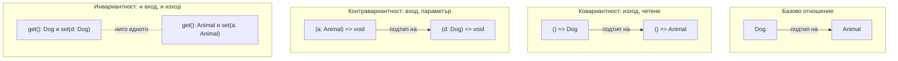

# Variance

Variance отговаря на въпроса: ако `Dog` е подтип на `Animal`, какво е отношението между `Box<Dog>` и `Box<Animal>`? Ако посоката се запазва (`Box<Dog>` е подтип на `Box<Animal>`), типът е ковариантен. Ако се обръща, е контравариантен. Ако не важи нито едното, е инвариантен. В TypeScript стойностите, които се четат (return типове, readonly свойства), са ковариантни, а параметрите на функции са контравариантни (с `strictFunctionTypes`).

## 1. За какво се ползва и защо ни е нужен

Variance изглежда академично, но обяснява реални грешки и реални дупки в типовата система:

- защо callback `(d: Dog) => void` не може да се подаде там, където се очаква `(a: Animal) => void`;
- защо масивите в TypeScript са "нездрави" (unsound): `Dog[]` може да се присвои на `Animal[]`, после в масива се добавя `Cat`;
- защо методите и свойствата-функции в interface се проверяват различно;
- защо понякога generic клас дава неочаквана грешка за съвместимост.

На интервю за senior позиция въпросът "защо параметрите са контравариантни" е класически.

## 2. Посоките



Интуицията:

- **Изход (ковариантност):** функция, която връща `Dog`, става навсякъде, където се очаква функция, която връща `Animal`. Получателят чака животно и получава куче. Безопасно.
- **Вход (контравариантност):** функция, която приема всяко `Animal`, става там, където ще бъде извикана с `Dog`. Обратното не: функция, която очаква `Dog` и вика `d.bark()`, ще гръмне, ако ѝ подадат `Cat`.
- **Вход и изход:** тип, който и чете, и пише `T`, е безопасен само при точно съвпадение.

## 3. Минимален пример

```ts variance.ts
interface Animal { name: string }
interface Dog extends Animal { bark(): void }
interface Cat extends Animal { meow(): void }

// Ковариантност на return типа
let getAnimal: () => Animal;
const getDog = (): Dog => ({ name: 'Рекс', bark() {} });
getAnimal = getDog;                       // ОК

// Контравариантност на параметъра (strictFunctionTypes)
let handleDog: (d: Dog) => void;
let handleAnimal: (a: Animal) => void = (a) => console.log(a.name);
handleDog = handleAnimal;                 // ОК: приема всяко животно, значи и куче
handleAnimal = (d: Dog) => d.bark();      // Грешка: ще бъде извикан с Cat и ще гръмне

// Методи срещу свойства-функции
interface MethodStyle { handle(a: Animal): void }      // метод: бивариантен
interface PropStyle { handle: (a: Animal) => void }    // свойство: контравариантно

const m: MethodStyle = { handle(d: Dog) { d.bark(); } };   // компилира се (дупка)
const p: PropStyle = { handle: (d: Dog) => d.bark() };     // Грешка
```

## 4. Дупките: масиви и методи

```ts unsound.ts
interface Animal { name: string }
interface Dog extends Animal { bark(): void }
interface Cat extends Animal { meow(): void }

const dogs: Dog[] = [{ name: 'Рекс', bark() {} }];
const animals: Animal[] = dogs;           // ОК: масивите са ковариантни
animals.push({ name: 'Мурка' } as Cat);   // компилира се
dogs[1].bark();                           // runtime: TypeError, bark is not a function
```

Масивите са и за четене, и за писане, така че правилно би трябвало да са инвариантни. TypeScript съзнателно ги прави ковариантни, защото иначе почти всеки реален JavaScript код би давал грешки. Същата причина стои зад бивариантността на методите: `Array<T>.push(item: T)` е метод, и ако беше строго контравариантен, `Dog[]` нямаше да е съвместим с `Animal[]`. `readonly Dog[]` и `ReadonlyArray<Dog>` са безопасно ковариантни, защото нямат методи за писане.

## 5. Явни анотации: in и out

От TS 4.7 можеш да декларираш variance на типов параметър. Компилаторът проверява, че декларацията е вярна, и може да пропусне скъпото структурно сравнение.

```ts annotations.ts
interface Producer<out T> {       // T само в изходни позиции
  get(): T;
}
interface Consumer<in T> {        // T само във входни позиции
  accept(value: T): void;
}
interface Store<in out T> {       // и двете: инвариантен
  get(): T;
  set(value: T): void;
}
```

В приложен код рядко ги пишеш. Полезни са в библиотеки с дълбоко вложени generic типове, където помагат на производителността на компилатора и правят грешките по-ясни.

## 6. Въпроси на интервю

### Какво е ковариантност и контравариантност?

Ковариантност: отношението на подтиповете се запазва (`Dog` е подтип на `Animal`, значи `() => Dog` е подтип на `() => Animal`). Контравариантност: отношението се обръща (`(a: Animal) => void` е подтип на `(d: Dog) => void`). Позициите за изход (return, readonly свойства) са ковариантни, позициите за вход (параметри) са контравариантни.

### Защо параметрите на функции са контравариантни?

Защото функцията ще бъде извикана с аргументи от очаквания тип. Ако на място, където ще се подава всяко `Animal`, сложиш функция, която очаква `Dog` и вика `bark()`, тя ще получи `Cat` и ще гръмне. Безопасно е обратното: функция, която приема по-общ тип от необходимото.

### Какво прави `strictFunctionTypes`?

Включва контравариантна проверка на параметрите за функционални типове. Без него параметрите са бивариантни (приемат се и в двете посоки), което е дупка. Част е от `strict`. Не се прилага за методи (декларирани със синтаксиса `method(x): void`), заради съвместимост с масивите и DOM типовете.

### Здрава (sound) ли е типовата система на TypeScript?

Не, и съзнателно. Масивите са ковариантни въпреки че са записваеми, методите са бивариантни, `any` изключва проверката, индексирането без `noUncheckedIndexedAccess` не добавя `undefined`, `as` вярва на програмиста. Целта на TypeScript е полезност за реален JavaScript, не математическа здравина.

### Как да направиш callback параметрите строги в собствените си interfaces?

Декларирай ги като свойства с функционален тип (`handle: (a: Animal) => void`), а не като методи (`handle(a: Animal): void`). Линтерът `@typescript-eslint/method-signature-style` налага това.

## 7. Капани и чести грешки

- Методи в interface, които тихо приемат по-тесен параметър.
- Присвояване на `Dog[]` на `Animal[]` и писане в него.
- Изключен `strict` (или `strictFunctionTypes`) в стар проект.
- Объркване на посоката: "подтип" значи "може да се подаде на мястото на", не "има по-малко свойства".

## 8. Свързани документи

- [Структурно типизиране](Structural_Typing.md)
- [Generics](Generics.md)
- [tsconfig и strict](Tsconfig.md)
- [any, unknown, never и йерархията](Type_Hierarchy.md)
