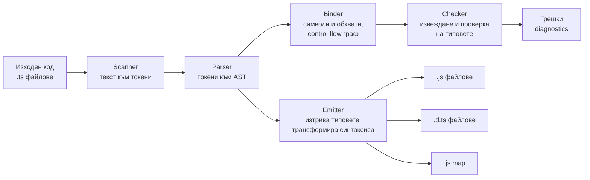
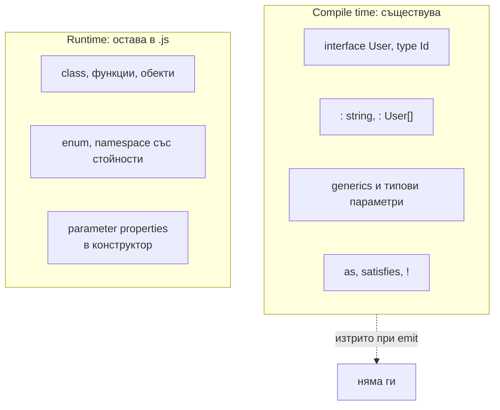

# Компилаторът и type erasure

TypeScript е JavaScript с добавена статична типова система. Компилаторът (`tsc`) прави две отделни неща: проверява типовете и превръща кода в обикновен JavaScript, като изтрива всички типови анотации. Типовете съществуват само по време на компилация. В runtime няма и следа от тях, затова TypeScript не може да валидира данни, които идват отвън.

## 1. За какво се ползва и защо ни е нужен

JavaScript открива грешките чак когато кодът се изпълни: `undefined is not a function` в production, грешно име на поле, функция, извикана с аргументите в грешен ред. TypeScript ги открива при писане на кода.

- **Грешки преди runtime:** липсващи полета, `null` там, където не се очаква, необработен случай в `switch`.
- **Инструменти:** автоматично довършване, rename и "go to definition" в редактора идват от същия компилатор (language service).
- **Документация, която не остарява:** сигнатурата на функция казва какво приема и какво връща, и компилаторът следи това да е вярно.
- **Безопасен рефакторинг:** смениш ли формата на обект, компилаторът показва всяко място, което трябва да се промени.

На интервю ключовото е да разграничиш compile time от runtime. Типовете не съществуват в изпълнението, не правят кода по-бърз и не пазят от лоши данни от API.

## 2. Как работи компилаторът



| Етап | Какво прави | Пример |
|---|---|---|
| Scanner | Разделя текста на токени | `const`, `x`, `:`, `number`, `=` |
| Parser | Строи абстрактно синтактично дърво (AST) | `VariableDeclaration` с име, тип и стойност |
| Binder | Свързва имената с декларации (символи), строи графа на control flow | Знае, че `x` в ред 10 е същият като в ред 2 |
| Checker | Извежда и проверява типовете. Най-големият и най-бавният етап | `Type 'string' is not assignable to type 'number'` |
| Emitter | Генерира JavaScript, декларации и source maps | Маха `: number`, превръща `enum` в обект |

Важното: emit не зависи от проверката. По подразбиране `tsc` генерира JavaScript дори при типови грешки (освен с `noEmitOnError`). Затова инструменти като esbuild, swc и Node могат да "компилират" TypeScript, без изобщо да проверяват типове: просто махат анотациите. Виж [Build и производителност](Build_Tooling.md).

## 3. Type erasure



Повечето TypeScript синтаксис просто изчезва. Има няколко изключения, които генерират код: `enum`, `namespace` със стойности и parameter properties (`constructor(private x: number)`). Тях Node не може да изпълни с type stripping. Затова съвременният съвет е да се избягват (виж [Enums и алтернативи](Enums.md)).

## 4. Минимален пример

```ts user.ts
interface User {
  id: number;
  name: string;
}

function greet(user: User): string {
  return `Здравей, ${user.name}`;
}

greet({ id: 1, name: 'Ана' });       // ОК
greet({ id: 1 });                    // Грешка при компилация: липсва 'name'

const fromApi = JSON.parse('{"id": 1}') as User;   // компилаторът вярва на "as"
greet(fromApi);                      // компилира се, в runtime връща "Здравей, undefined"
```

Генерираният JavaScript:

```js user.js
function greet(user) {
  return `Здравей, ${user.name}`;
}
greet({ id: 1, name: 'Ана' });
greet({ id: 1 });
const fromApi = JSON.parse('{"id": 1}');
greet(fromApi);
```

`interface`, анотациите и `as User` изчезват. Втората грешка е открита от компилатора. Третата не е: `as` казва на компилатора "вярвай ми", а в runtime проверка няма. Виж [Runtime граница и валидация](Runtime_Boundary.md).

## 5. Въпроси на интервю

### Какво е TypeScript?

Надмножество на JavaScript със статична, структурна, опционална типова система. Всеки валиден JavaScript е (почти) валиден TypeScript. Компилаторът проверява типовете и генерира JavaScript, като изтрива типовете.

### Има ли типовете ефект в runtime?

Не. Типовете се изтриват при компилация. Не можеш да направиш `if (x instanceof User)`, ако `User` е interface, нито да провериш generic параметър в runtime. Затова данни отвън (HTTP, JSON, база) трябва да се валидират с код, например със zod.

### Прави ли TypeScript кода по-бърз?

Не. Изходът е обикновен JavaScript, а V8 не знае за типовете. Косвено може да помогне: кодът с типове обикновено подава обекти с еднаква форма, което V8 оптимизира добре. Но това е ефект от дисциплината, не от TypeScript.

### Какво значи "tsc генерира JS дори при грешки"?

Проверката и emit-ът са независими етапи. Типовите грешки са диагностики, не спират генерирането на код, освен ако не е зададено `noEmitOnError`. В CI обикновено `tsc --noEmit` проверява типовете, а друг инструмент генерира кода.

### Кои конструкции на TypeScript генерират runtime код?

`enum` (обект с обратно съпоставяне при числови), `namespace` със стойности, parameter properties в конструктор и старите `experimentalDecorators` с metadata. Всичко останало (типове, interfaces, generics, `as`, `!`) се изтрива.

### Какво е `.d.ts` файл?

Файл само с типови декларации, без имплементация. Описва формата на JavaScript код, за да може TypeScript да го ползва. `tsc` с `declaration: true` ги генерира, а пакетите `@types/*` ги дават за библиотеки, написани на JavaScript. Виж [Модули и .d.ts файлове](Modules_Declarations.md).

## 6. Капани и чести грешки

- Да мислиш, че анотация на тип валидира данни. `const u: User = await res.json()` компилира и не проверява нищо.
- `as` за "поправка" на грешка: заглушава компилатора, не решава проблема.
- `instanceof` с interface или type alias: те не съществуват в runtime.
- Разчитане на `tsc` за генериране, без `--noEmit` проверка в CI: кодът с типови грешки стига до production.
- Объркване на "TypeScript грешка" с "runtime грешка". Кодът с типова грешка може да работи, а кодът без грешки може да гърми.

## 7. Свързани документи

- [Структурно типизиране](Structural_Typing.md)
- [Runtime граница и валидация](Runtime_Boundary.md)
- [Build и производителност](Build_Tooling.md)
- [Enums и алтернативи](Enums.md)
